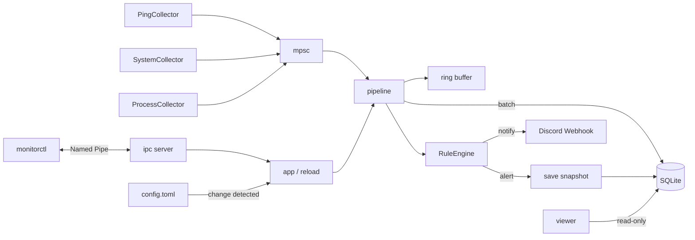

<div align="center">


# traffic-watcher

A resident monitoring tool for Windows that helps you find out afterwards why your ping spiked during a game.

[](https://github.com/Harukoto-Project/traffic-watcher/actions/workflows/ci.yml)


[Overview](#overview) · [Features](#features) · [Viewer](#viewer) · [Setup](#setup) · [Usage](#usage) · [Configuration](#configuration) · [Architecture](#architecture) · [License](#license)

[日本語](README.md) · [English](README.en.md) · [한국어](README.ko.md)

</div>

---

## Overview

traffic-watcher consists of `monitord`, a resident monitoring daemon written in Rust, `monitorctl`, a CLI for inspecting the data, and a desktop viewer.

The first use case is isolating "ping that spikes irregularly during a game". It pings your router and an external host (`1.1.1.1`) at the same instant, and records the results together with the CPU, memory, NIC throughput, and heaviest processes at that same moment. Afterwards you can tell whether the delay came from the LAN, the ISP side, or load on the PC.

| Component | Role |
|---|---|
| `monitord` | Resident daemon that measures, stores, evaluates alerts, and notifies. Runs in a console or as a Windows service |
| `monitorctl` | CLI that queries the daemon or reads the SQLite file directly |
| Viewer | Desktop app that shows the stored data as charts and tables (`apps/viewer`) |

---

## Features

### Measuring and recording

- ICMP ping (`IcmpSendEcho`, works with normal user privileges). Multiple targets are recorded with the same timestamp (UTC milliseconds)
- system Collector: CPU usage, memory, disk usage, and NIC send/receive bytes per second
- process Collector: the top N processes by CPU usage and memory usage
- Batched writes to SQLite (WAL). Raw data past the retention period is folded into hourly aggregates before it is deleted

### Alerts and notifications

- Alert rules: condition expression, consecutive count, and cooldown
- Snapshots: every event before and after an alert (30 seconds before and 15 seconds after by default) is saved to separate tables and is not removed by the normal data retention
- Discord Webhook notifications (retried once on failure)

### Operation and inspection

- Hot reload that detects config file changes (an invalid config is rejected and the previous one is kept)
- Detects Collector crashes and panics and restarts them with exponential backoff
- Windows service (LocalSystem, automatic start, automatic restart on failure)
- Status and history over a Named Pipe, and the `monitorctl` CLI
- A desktop viewer for charts and tables

---

## Viewer

A desktop app built with Tauri (Rust + React), located in `apps/viewer`. It opens the SQLite database written by the daemon in read-only mode, so you can compare values and time series on a shared timeline.

> [!NOTE]
> The viewer is under development. Its screens and appearance may change.

### Screens

| Category | Screen | Content |
|---|---|---|
| Status | Overview | Summary of system metrics such as CPU and memory, per-target ping summary, and database information |
| Status | Timeline | Time-series charts for ping, packet loss, CPU and memory, and network. Snapshot trigger times are overlaid |
| Status | Long-term aggregates | Hourly aggregates, including periods already removed by retention. Choose from ping round-trip time, loss rate, CPU, memory, and network receive/send |
| Records | Snapshots | List and details per alert. Ping, system, process ranking, and surrounding events on the same time axis |
| Records | Events | Event list filterable by source and kind. Shows the latest 200 / 1000 / 5000 events |

Overview, Timeline, Long-term aggregates, and Events let you switch the displayed range (15 minutes, 1 hour, 6 hours, 24 hours, 7 days, all time, or a custom range). The theme can be light, dark, or automatic.

### Choosing a database

On startup the viewer tries the database you opened last time, and then an automatically detected one. The auto-detection looks in these places:

- `data\monitor.db`, searching up to 6 levels above the current directory and above the executable's location
- `%ProgramData%\monitor\monitor.db` (where the service stores its data)

If nothing is found, or you want to view another file, pick a file from the database controls at the bottom of the sidebar.

### Running and building

Run these in `apps\viewer`. Install the dependencies the first time.

```powershell
cd apps\viewer
yarn install
```

Start in development mode:

```powershell
yarn tauri dev
```

Build an installer (NSIS):

```powershell
yarn tauri build
```

The output goes to `target\release\bundle\nsis\`.

---

## Setup

### Requirements

- Windows
- Rust (stable)
- To use the viewer: Node.js, yarn, and WebView2 and the MSVC build tools for building Tauri

### Build

```powershell
cargo build --release -p monitord -p monitorctl
```

The outputs are `target\release\monitord.exe` (daemon) and `target\release\monitorctl.exe` (CLI).

---

## Usage

### Run in a console

```powershell
cargo run -p monitord -- --console
```

- Stop with Ctrl+C
- The config is `config/default.toml`. Data is stored in `data/monitor.db`
- You can inspect it with `monitorctl` from another terminal

### Run as a Windows service

The service config is `config/service.toml` (data goes to `C:\ProgramData\monitor`). A service has no fixed working directory, so `daemon.data_dir` must be an absolute path.

Run these in a PowerShell with administrator privileges.

```powershell
.\target\release\monitord.exe install --config config\service.toml
.\target\release\monitord.exe start
```

| Command | Description |
|---|---|
| `monitord install --config <PATH>` | Register the service (automatic start, LocalSystem, restart after 5 / 30 / 60 seconds on failure) |
| `monitord start` | Start |
| `monitord stop` | Stop |
| `monitord uninstall` | Stop and remove |

- If you move `monitord.exe` or the config file after `install`, run `uninstall` and then `install` again
- Logs are written to `<data_dir>\logs\monitord.<date>.log` (daily rotation, 14 generations)
- If loading the config fails before startup, the error is written to `%ProgramData%\monitor\monitord-startup-error.log`

### Discord Webhook

The Webhook URL can be encrypted with DPAPI (machine scope) and written into the config.

```powershell
.\target\release\monitord.exe protect-secret
```

Enter the URL and it prints `url_protected = "..."`. Paste it into `[webhook]` in the config file.

```toml
[webhook]
url_protected = "0100000..."
```

- A plaintext `url = "https://..."` is also accepted (`http` is allowed only for loopback)
- The encryption uses machine scope, so other users and services on the same PC can decrypt it. Protect the config file with an ACL
- A notification is sent only when a rule's `notify` includes `"webhook"`. If no URL is set, only a warning is logged

### monitorctl

Queries the daemon over a Named Pipe (`\\.\pipe\monitord`).

```powershell
monitorctl status
monitorctl summary --minutes 60
monitorctl history --minutes 5 --source "ping:*"
monitorctl snapshots
monitorctl snapshot 3
monitorctl hourly --hours 48
monitorctl reload
monitorctl set-interval 250
```

| Command | Description |
|---|---|
| `status` | Uptime, event count, alert count, last reload result, and the latest value of each source |
| `summary --minutes N` | Per-target sample count, loss rate, average, P95, P99, and maximum |
| `history --minutes N --source S --limit N` | Event list. `source` accepts `*` as a wildcard (for example `ping:*`, `alert:*`, `system`) |
| `snapshots [--limit N]` / `snapshot <ID>` | List of alert snapshots (20 by default) and details |
| `hourly --hours N --source S` | Hourly aggregates, including periods already removed by retention |
| `reload` | Reload the config |
| `set-interval <MS>` | Temporarily change the ping interval (valid until the next reload) |

Common options:

| Option | Description |
|---|---|
| `--pipe <NAME>` | Named Pipe name. Defaults to `monitord` |
| `--db <PATH>` | Read SQLite directly in read-only mode without going through the daemon (`history` / `summary` / `hourly` / `snapshots` / `snapshot`) |
| `--json` | Output formatted JSON |

---

## Configuration

See `config/default.toml`. Every section has defaults, and unknown keys are an error (unsupported values such as `toast` are also rejected).

| Key | Default | Description |
|---|---|---|
| `daemon.data_dir` | `data` | Where the DB and logs are stored |
| `daemon.log_level` | `info` | `error` / `warn` / `info` / `debug` / `trace` |
| `ping.interval_ms` | `1000` | Measurement interval (100 or more). Shared by all targets |
| `ping.timeout_ms` | `1000` | Timeout while waiting for a reply |
| `ping.targets` | none | Array of `name` (unique) and `host`. An IPv4 address or a host name |
| `system.enabled` / `system.interval_ms` | `true` / `2000` | system Collector (500 or more) |
| `process.enabled` / `process.interval_ms` / `process.top_n` | `true` / `10000` / `5` | process Collector (1000 or more) |
| `storage.retention_days` | `7` | Days to keep raw data |
| `storage.snapshot_retention_days` | `90` | Days to keep snapshots |
| `storage.flush_interval_ms` | `1000` | Interval for writing to the DB (100 or more) |
| `alert.pre_seconds` / `alert.post_seconds` | `30` / `15` | Seconds before and after to include in a snapshot |
| `webhook.url` / `webhook.url_protected` | none | Discord Webhook URL (`url_protected` takes precedence) |
| `ipc.enabled` / `ipc.pipe_name` | `true` / `monitord` | Named Pipe |

Targets, Collectors, alert rules, the Webhook, and retention are applied by hot reload. Changes to `daemon.data_dir`, `daemon.log_level`, and `ipc.*` require a restart (a warning is logged on reload).

### Alert rules

```toml
[[alert.rules]]
name = "ping_spike"
source = "ping:*"
condition = "rtt_ms > 100"
consecutive = 3
cooldown_sec = 300
notify = ["log", "webhook"]
snapshot = true
```

| Key | Default | Description |
|---|---|---|
| `name` | required | Rule name (unique). The alert's `source` is `alert:<name>` |
| `source` | required | Target source. `*` works as a wildcard |
| `condition` | required | `<field> <operator> <value>`. Operators are `>` `>=` `<` `<=` `==` `!=`. The value is a number, `true` / `false`, or a string |
| `consecutive` | `1` | Number of consecutive times the condition was met, counted per source |
| `cooldown_sec` | `300` | Seconds during which repeated notifications for the same rule and source are suppressed |
| `notify` | `["log"]` | `log` / `webhook` |
| `snapshot` | `true` | Whether to save a snapshot around the alert |

- An event that lacks the field (for example `rtt_ms` for a lost ping) is treated as "condition not met" and resets the consecutive count. Detect loss with a rule on `ok == false`
- On a config reload, the consecutive count and cooldown of rules whose definition did not change are carried over

### Data model

The SQLite file is `<data_dir>/monitor.db`.

| Table | Description |
|---|---|
| `events` | Raw data. `ts_ms` (UTC Unix milliseconds), `source`, `kind` (`metric` / `alert` / `info`), `fields` (JSON) |
| `snapshots` / `snapshot_events` | Snapshots per alert and the events around them |
| `hourly` | Hourly aggregates. `source`, `hour_ms`, `metric`, `samples`, `avg`, `min`, `max` |

`hourly` covers `rtt_ms` / `ok` (success rate) of `ping:*`, and `cpu_pct` / `mem_used_pct` / `rx_bytes_s` / `tx_bytes_s` of `system`.

`fields` per source:

| source | Keys |
|---|---|
| `ping:<name>` | `host`, `addr`, `ok`, `status` (`0` on success), `rtt_ms` (only on success), `error` (only when ICMP could not be sent, for example due to name resolution) |
| `system` | `cpu_pct`, `mem_used_pct`, `mem_used_mb`, `mem_total_mb`, `rx_bytes_s`, `tx_bytes_s`, `net_top_iface`, `disk_used_pct`, `disk_total_gb` |
| `process` | `process_count`, `cpu_top<N>_name` / `_pid` / `_pct`, `mem_top<N>_name` / `_pid` / `_mb` |
| `alert:<rule>` | `rule`, `target`, `message`, `consecutive`, `value` |

Example query for checking the data:

```sql
SELECT ts_ms, source, fields FROM events ORDER BY id DESC LIMIT 10;
```

---

## Architecture



| Path | Content |
|---|---|
| `crates/core` | The `Event` type, the `Collector` trait, and shared models used by IPC |
| `crates/collectors` | ping / system / process Collectors |
| `crates/storage` | SQLite, queries, snapshots, hourly aggregation, retention |
| `crates/alert` | Condition expressions, rule evaluation, Discord Webhook |
| `crates/ipc` | Named Pipe server/client, protocol, query execution |
| `crates/daemon` | `monitord`: config, pipeline, supervisor, service, DPAPI |
| `crates/cli` | `monitorctl` |
| `apps/viewer` | The viewer. `src-tauri` is the Rust side of Tauri and `src` is the React UI |
| `config/` | `default.toml` (for console), `service.toml` (for service) |

---

## Roadmap

- [x] M1: Ping from a console and save to SQLite
- [x] M2: Windows service (install / uninstall / start / stop)
- [x] M3: system / process Collectors
- [x] M4: Alert rules and saving snapshots around a spike
- [x] M5: Named Pipe and `monitorctl`
- [x] M6: Discord Webhook and config hot reload
- [ ] M7: Desktop viewer (`apps/viewer`). The screens are implemented and development continues

---

## Security

- The Named Pipe is `\\.\pipe\monitord`. Remote clients are rejected. The ACL grants full access to SYSTEM and Administrators, and read/write access to interactively logged-on users. A second daemon instance is detected by failing to create the first pipe instance, and it exits with an error
- IPC operations are limited to getting status, getting history, reloading the config, and temporarily changing the ping interval. It cannot run arbitrary commands or rewrite the config
- For protecting the Webhook URL, see DPAPI above
- The viewer opens the database in read-only mode

## Known limitations

- IPv4 only
- ICMP, the service, the Named Pipe, and DPAPI are Windows-only (the project builds on other OSes but fails at runtime)
- Notifications are limited to the log and the Discord Webhook. Toast notifications are not supported (a service runs in session 0, so they would need a resident client in the user session)
- Ping sends to all targets at the same time and waits for every result, so a target that does not respond stretches the measurement cycle of all targets by up to `timeout_ms`
- `rtt_ms` is measured with `Instant` before and after the call, not the value returned by the API
- To avoid load, disk usage is refreshed only once every 30 system samples
- CPU usage of system / process and NIC throughput are values from `sysinfo`
- The viewer is available in Japanese only

## Development

Run the same checks as CI.

```powershell
cargo fmt --all --check
cargo clippy --workspace --all-targets -- -D warnings
cargo test --workspace
```

Check the viewer's frontend in `apps\viewer`.

```powershell
yarn typecheck
yarn lint
yarn format:check
```

## Contributing

Issues and Pull Requests are welcome. See [CONTRIBUTING.md](CONTRIBUTING.md) for the procedure (written in Japanese).

## License

You may use this project under either of the following licenses.

- [Apache License, Version 2.0](LICENSE-APACHE)
- [MIT License](LICENSE-MIT)
