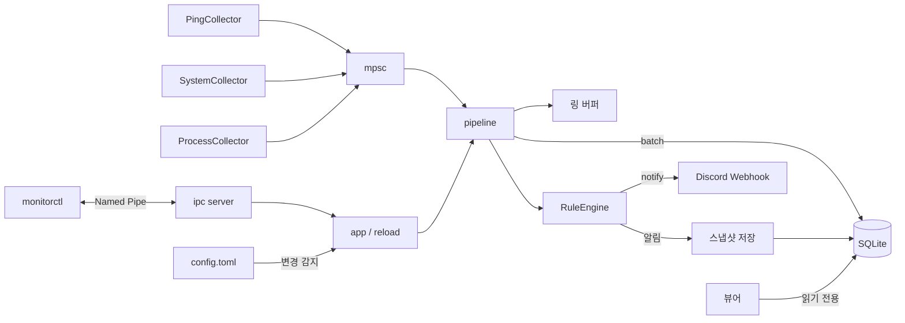

<div align="center">


# traffic-watcher

게임 중 Ping이 튄 원인을 나중에 가려내기 위한 Windows용 상주 모니터링 도구.

[](https://github.com/Harukoto-Project/traffic-watcher/actions/workflows/ci.yml)


[개요](#개요) · [기능](#기능) · [뷰어](#뷰어) · [설치](#설치) · [사용법](#사용법) · [설정](#설정) · [구성](#구성) · [라이선스](#라이선스)

[日本語](README.md) · [English](README.en.md) · [한국어](README.ko.md)

</div>

---

## 개요

traffic-watcher는 Rust로 만든 상주 모니터링 데몬 `monitord`, 확인용 CLI인 `monitorctl`, 데스크톱 뷰어로 구성된다.

첫 번째 사용 사례는 "게임 중 Ping이 불규칙하게 튀는 문제"의 원인 분리다. 라우터와 외부 호스트(`1.1.1.1`)에 같은 시각에 ping을 보내고, 같은 시각의 CPU, 메모리, NIC 송수신량, 부하가 큰 프로세스와 함께 기록한다. 지연의 원인이 LAN 내부인지, 회선 쪽인지, PC의 부하인지 나중에 판별할 수 있다.

| 구성 요소 | 역할 |
|---|---|
| `monitord` | 측정, 저장, 알림 규칙 평가, 통지를 수행하는 상주 데몬. 콘솔에서도 Windows 서비스로도 동작한다 |
| `monitorctl` | 데몬에 질의하거나 SQLite를 직접 읽는 CLI |
| 뷰어 | 저장된 데이터를 그래프와 표로 확인하는 데스크톱 앱(`apps/viewer`) |

---

## 기능

### 측정과 기록

- ICMP ping(`IcmpSendEcho`. 일반 사용자 권한으로 동작). 여러 대상을 같은 타임스탬프(UTC 밀리초)로 기록
- system Collector: CPU 사용률, 메모리, 디스크 사용률, NIC의 초당 송수신 바이트
- process Collector: CPU 사용률과 메모리 사용량 상위 N개 프로세스
- SQLite(WAL)에 배치로 저장. 보존 기간이 지난 원본 데이터는 1시간 단위 집계로 합친 뒤 삭제

### 알림과 통지

- 알림 규칙: 조건식, 연속 횟수, 쿨다운
- 스냅샷: 알림 발생 전후(기본값은 앞 30초, 뒤 15초)의 모든 이벤트를 별도 테이블에 저장. 일반 데이터의 retention으로는 삭제되지 않음
- Discord Webhook 통지(실패 시 1회 재시도)

### 운영과 확인

- 설정 파일의 변경을 감지하는 핫 리로드(잘못된 설정은 거부하고 이전 설정을 유지)
- Collector의 비정상 종료와 panic을 감지해 지수 백오프로 재시작
- Windows 서비스(LocalSystem, 자동 시작, 비정상 종료 시 자동 재시작)
- Named Pipe를 통한 상태 확인과 기록 조회, CLI `monitorctl`
- 데스크톱 뷰어에서 그래프와 표로 확인

---

## 뷰어

`apps/viewer`에 있는 Tauri(Rust + React) 기반 데스크톱 앱. 데몬이 기록한 SQLite 데이터베이스를 읽기 전용으로 열어, 시각을 맞춰 수치와 시계열을 비교할 수 있다.

> [!NOTE]
> 뷰어는 개발 중이다. 화면 구성과 외형은 앞으로 바뀔 수 있다.

### 화면

| 분류 | 화면 | 내용 |
|---|---|---|
| 상황 | 개요 | CPU, 메모리 등 시스템 요약, 대상별 ping 요약, 데이터베이스 정보 |
| 상황 | 타임라인 | ping 추이, 패킷 손실, CPU와 메모리, 네트워크의 시계열 그래프. 스냅샷 발생 시각을 겹쳐 표시 |
| 상황 | 장기 집계 | retention으로 삭제된 기간을 포함한 1시간 집계. ping 왕복 시간, 손실률, CPU, 메모리, 네트워크 수신/송신 중에서 선택 |
| 기록 | 스냅샷 | 알림별 목록과 상세. ping, 시스템, 프로세스 순위, 전후 이벤트를 같은 시간축에서 확인 |
| 기록 | 이벤트 | 소스와 종류로 필터링할 수 있는 이벤트 목록. 표시 개수는 최신 200 / 1000 / 5000건 |

개요, 타임라인, 장기 집계, 이벤트는 기간(15분, 1시간, 6시간, 24시간, 7일, 전체 기간, 직접 지정)으로 표시 범위를 바꿀 수 있다. 테마는 라이트, 다크, 자동 중에서 고를 수 있다.

### 데이터베이스 선택

시작할 때는 지난번에 연 데이터베이스, 그다음 자동 감지한 데이터베이스 순서로 연다. 자동 감지 위치는 다음과 같다.

- 현재 디렉터리와 실행 파일 위치에서 최대 6단계 위까지의 `data\monitor.db`
- `%ProgramData%\monitor\monitor.db`(서비스 실행 시 저장 위치)

찾지 못했거나 다른 파일을 보고 싶을 때는 사이드바 하단의 데이터베이스 조작에서 파일을 선택한다.

### 실행과 빌드

`apps\viewer`에서 실행한다. 처음에는 의존성을 설치한다.

```powershell
cd apps\viewer
yarn install
```

개발 모드로 실행한다.

```powershell
yarn tauri dev
```

설치 프로그램(NSIS)을 만든다.

```powershell
yarn tauri build
```

결과물은 `target\release\bundle\nsis\`에 출력된다.

---

## 설치

### 요구 사항

- Windows
- Rust(stable)
- 뷰어를 사용하려면 Node.js, yarn, 그리고 Tauri 빌드를 위한 WebView2와 MSVC 빌드 도구

### 빌드

```powershell
cargo build --release -p monitord -p monitorctl
```

결과물은 `target\release\monitord.exe`(데몬)와 `target\release\monitorctl.exe`(CLI)다.

---

## 사용법

### 콘솔에서 실행

```powershell
cargo run -p monitord -- --console
```

- 종료는 Ctrl+C
- 설정은 `config/default.toml`. 데이터는 `data/monitor.db`
- 다른 터미널에서 `monitorctl`로 확인할 수 있다

### Windows 서비스로 실행

서비스용 설정은 `config/service.toml`(데이터는 `C:\ProgramData\monitor`). 서비스는 작업 디렉터리가 고정되지 않으므로 `daemon.data_dir`은 반드시 절대 경로여야 한다.

관리자 권한의 PowerShell에서 실행한다.

```powershell
.\target\release\monitord.exe install --config config\service.toml
.\target\release\monitord.exe start
```

| 명령 | 내용 |
|---|---|
| `monitord install --config <PATH>` | 서비스 등록(자동 시작, LocalSystem, 비정상 종료 시 5 / 30 / 60초 후 재시작) |
| `monitord start` | 시작 |
| `monitord stop` | 중지 |
| `monitord uninstall` | 중지 후 삭제 |

- `install` 후에 `monitord.exe`나 설정 파일을 옮겼다면 `uninstall`한 뒤 다시 `install`한다
- 로그는 `<data_dir>\logs\monitord.<날짜>.log`(일 단위 로테이션, 14세대)
- 시작 전에 설정 읽기에 실패하면 `%ProgramData%\monitor\monitord-startup-error.log`에 기록한다

### Discord Webhook

Webhook URL은 DPAPI(머신 스코프)로 암호화해서 설정에 쓸 수 있다.

```powershell
.\target\release\monitord.exe protect-secret
```

URL을 입력하면 `url_protected = "..."`가 출력되므로, 설정 파일의 `[webhook]`에 붙여 넣는다.

```toml
[webhook]
url_protected = "0100000..."
```

- 평문 `url = "https://..."`도 지정할 수 있다(`http`는 루프백만 허용)
- 암호화는 머신 스코프이므로 같은 PC의 다른 사용자나 서비스에서도 복호화할 수 있다. 설정 파일의 ACL로 보호할 것
- 규칙의 `notify`에 `"webhook"`이 포함된 경우에만 전송한다. URL이 없으면 경고 로그만 남긴다

### monitorctl

데몬에 Named Pipe(`\\.\pipe\monitord`)로 질의한다.

```powershell
monitorctl status
monitorctl summary --minutes 60
monitorctl history --minutes 5 --source "ping:*"
monitorctl snapshots
monitorctl snapshot 3
monitorctl hourly --hours 48
monitorctl reload
monitorctl set-interval 250
```

| 명령 | 내용 |
|---|---|
| `status` | 가동 시간, 이벤트 수, 알림 수, 마지막 리로드 결과, 각 소스의 최신 값 |
| `summary --minutes N` | 대상별 샘플 수, 손실률, 평균, P95, P99, 최댓값 |
| `history --minutes N --source S --limit N` | 이벤트 목록. `source`에는 `*`를 와일드카드로 쓸 수 있다(예: `ping:*`, `alert:*`, `system`) |
| `snapshots [--limit N]` / `snapshot <ID>` | 알림 스냅샷 목록(기본 20건)과 상세 |
| `hourly --hours N --source S` | retention으로 삭제된 기간을 포함한 1시간 집계 |
| `reload` | 설정 다시 읽기 |
| `set-interval <MS>` | ping 간격을 일시적으로 변경(다음 리로드까지 유효) |

공통 옵션:

| 옵션 | 내용 |
|---|---|
| `--pipe <NAME>` | Named Pipe 이름. 기본값은 `monitord` |
| `--db <PATH>` | 데몬을 거치지 않고 SQLite를 읽기 전용으로 직접 참조(`history` / `summary` / `hourly` / `snapshots` / `snapshot`) |
| `--json` | 정리된 JSON으로 출력 |

---

## 설정

`config/default.toml`을 참고한다. 모든 섹션에 기본값이 있고, 알 수 없는 키는 오류가 된다(`toast` 같은 미지원 값도 거부한다).

| 키 | 기본값 | 내용 |
|---|---|---|
| `daemon.data_dir` | `data` | DB와 로그의 저장 위치 |
| `daemon.log_level` | `info` | `error` / `warn` / `info` / `debug` / `trace` |
| `ping.interval_ms` | `1000` | 측정 간격(100 이상). 모든 대상 공통 |
| `ping.timeout_ms` | `1000` | 응답 대기 타임아웃 |
| `ping.targets` | 없음 | `name`(고유)과 `host`의 배열. IPv4 주소 또는 호스트 이름 |
| `system.enabled` / `system.interval_ms` | `true` / `2000` | system Collector(500 이상) |
| `process.enabled` / `process.interval_ms` / `process.top_n` | `true` / `10000` / `5` | process Collector(1000 이상) |
| `storage.retention_days` | `7` | 원본 데이터 보존 일수 |
| `storage.snapshot_retention_days` | `90` | 스냅샷 보존 일수 |
| `storage.flush_interval_ms` | `1000` | DB 쓰기 간격(100 이상) |
| `alert.pre_seconds` / `alert.post_seconds` | `30` / `15` | 스냅샷에 포함할 전후 초 |
| `webhook.url` / `webhook.url_protected` | 없음 | Discord Webhook URL(`url_protected`가 우선) |
| `ipc.enabled` / `ipc.pipe_name` | `true` / `monitord` | Named Pipe |

대상, Collector, 알림 규칙, Webhook, 보존 기간은 핫 리로드로 반영된다. `daemon.data_dir`, `daemon.log_level`, `ipc.*`의 변경은 재시작이 필요하다(리로드 시 경고를 출력한다).

### 알림 규칙

```toml
[[alert.rules]]
name = "ping_spike"
source = "ping:*"
condition = "rtt_ms > 100"
consecutive = 3
cooldown_sec = 300
notify = ["log", "webhook"]
snapshot = true
```

| 키 | 기본값 | 내용 |
|---|---|---|
| `name` | 필수 | 규칙 이름(고유). 알림의 `source`는 `alert:<name>` |
| `source` | 필수 | 대상 소스. `*`를 와일드카드로 쓸 수 있다 |
| `condition` | 필수 | `<필드> <연산자> <값>`. 연산자는 `>` `>=` `<` `<=` `==` `!=`. 값은 숫자, `true` / `false`, 문자열 |
| `consecutive` | `1` | 조건을 연속으로 만족한 횟수. 소스별로 센다 |
| `cooldown_sec` | `300` | 같은 규칙과 소스의 재통지를 막는 초 |
| `notify` | `["log"]` | `log` / `webhook` |
| `snapshot` | `true` | 발생 전후의 스냅샷을 저장할지 여부 |

- 필드가 없는 이벤트(예: 손실이 났을 때의 `rtt_ms`)는 "조건을 만족하지 않음"으로 취급되어 연속 횟수가 초기화된다. 손실은 `ok == false` 규칙으로 감지한다
- 설정을 리로드할 때, 정의가 바뀌지 않은 규칙의 연속 횟수와 쿨다운은 이어받는다

### 데이터 모델

SQLite 파일은 `<data_dir>/monitor.db`다.

| 테이블 | 내용 |
|---|---|
| `events` | 원본 데이터. `ts_ms`(UTC Unix 밀리초), `source`, `kind`(`metric` / `alert` / `info`), `fields`(JSON) |
| `snapshots` / `snapshot_events` | 알림별 스냅샷과 그 전후의 이벤트 |
| `hourly` | 1시간 집계. `source`, `hour_ms`, `metric`, `samples`, `avg`, `min`, `max` |

`hourly`의 대상은 `ping:*`의 `rtt_ms` / `ok`(성공률)와 `system`의 `cpu_pct` / `mem_used_pct` / `rx_bytes_s` / `tx_bytes_s`다.

소스별 `fields`:

| source | 키 |
|---|---|
| `ping:<name>` | `host`, `addr`, `ok`, `status`(성공은 `0`), `rtt_ms`(성공 시에만), `error`(이름 확인 등으로 ICMP를 보내지 못한 경우에만) |
| `system` | `cpu_pct`, `mem_used_pct`, `mem_used_mb`, `mem_total_mb`, `rx_bytes_s`, `tx_bytes_s`, `net_top_iface`, `disk_used_pct`, `disk_total_gb` |
| `process` | `process_count`, `cpu_top<N>_name` / `_pid` / `_pct`, `mem_top<N>_name` / `_pid` / `_mb` |
| `alert:<rule>` | `rule`, `target`, `message`, `consecutive`, `value` |

확인용 쿼리 예:

```sql
SELECT ts_ms, source, fields FROM events ORDER BY id DESC LIMIT 10;
```

---

## 구성



| 경로 | 내용 |
|---|---|
| `crates/core` | `Event` 타입, `Collector` trait, IPC에서 쓰는 공통 모델 |
| `crates/collectors` | ping / system / process Collector |
| `crates/storage` | SQLite, 쿼리, 스냅샷, 시간 집계, retention |
| `crates/alert` | 조건식, 규칙 평가, Discord Webhook |
| `crates/ipc` | Named Pipe 서버/클라이언트, 프로토콜, 쿼리 실행 |
| `crates/daemon` | `monitord`. 설정, pipeline, supervisor, 서비스, DPAPI |
| `crates/cli` | `monitorctl` |
| `apps/viewer` | 뷰어. `src-tauri`는 Tauri의 Rust 쪽, `src`는 React UI |
| `config/` | `default.toml`(콘솔용), `service.toml`(서비스용) |

---

## 로드맵

- [x] M1: 콘솔에서 ping을 측정하고 SQLite에 저장
- [x] M2: Windows 서비스화(install / uninstall / start / stop)
- [x] M3: system / process Collector
- [x] M4: 알림 규칙과 스파이크 전후의 스냅샷 저장
- [x] M5: Named Pipe와 `monitorctl`
- [x] M6: Discord Webhook, 설정 핫 리로드
- [ ] M7: 데스크톱 뷰어(`apps/viewer`). 각 화면은 구현되어 있으며 개발을 이어가는 중

---

## 보안

- Named Pipe는 `\\.\pipe\monitord`. 원격 클라이언트는 거부하며, ACL은 SYSTEM과 Administrators에 전체 권한, 대화형 로그온 사용자에 읽기/쓰기를 허용한다. 데몬의 이중 실행은 파이프의 첫 인스턴스를 만들지 못하는 것으로 감지해 실패시킨다
- IPC로 할 수 있는 동작은 상태 조회, 기록 조회, 설정 리로드, ping 간격의 일시 변경뿐이다. 임의 명령 실행이나 설정 변경은 할 수 없다
- Webhook URL의 보호는 위의 DPAPI를 참고
- 뷰어는 데이터베이스를 읽기 전용으로 연다

## 알려진 제한

- IPv4만 지원
- ICMP, 서비스, Named Pipe, DPAPI는 Windows 전용(다른 OS에서도 빌드는 되지만 실행 시 오류가 난다)
- 통지는 로그와 Discord Webhook뿐이다. 토스트 알림은 미지원(서비스는 세션 0에서 동작하므로, 구현하려면 사용자 세션 쪽 상주 클라이언트가 필요하다)
- ping은 모든 대상에 동시에 보내고 모든 결과를 기다리므로, 응답하지 않는 대상이 있으면 그만큼 모든 대상의 측정 주기가 `timeout_ms`에 끌려간다
- `rtt_ms`는 API의 반환값이 아니라 호출 전후의 `Instant`로 잰 실측값이다
- 디스크 사용률은 부하를 피하기 위해 system 샘플 30회에 한 번만 갱신한다
- system / process의 CPU 사용률과 NIC 송수신량은 `sysinfo`의 값이다
- 뷰어의 표시 언어는 일본어뿐이다

## 개발

CI와 같은 확인을 수행한다.

```powershell
cargo fmt --all --check
cargo clippy --workspace --all-targets -- -D warnings
cargo test --workspace
```

뷰어의 프런트엔드는 `apps\viewer`에서 확인한다.

```powershell
yarn typecheck
yarn lint
yarn format:check
```

## 기여

Issue와 Pull Request를 환영한다. 절차는 [CONTRIBUTING.md](CONTRIBUTING.md)(일본어)를 참고한다.

## 라이선스

다음 중 하나를 골라 이용할 수 있다.

- [Apache License, Version 2.0](LICENSE-APACHE)
- [MIT License](LICENSE-MIT)
