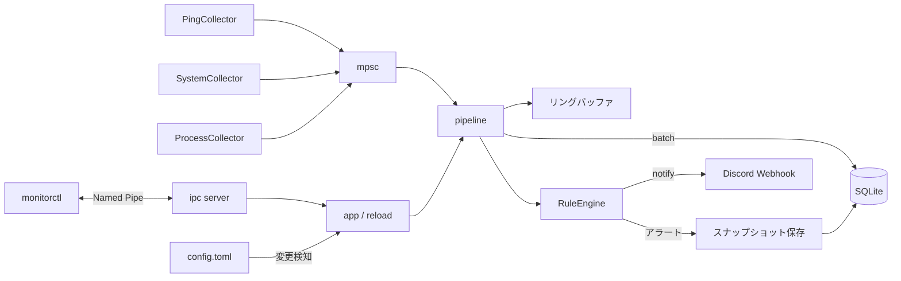

# traffic-watcher

Windows向けの常駐監視デーモン(Rust製)。

最初のユースケースは「ゲーム中のPingが不定期に跳ねる問題」の切り分け。ルーター宛てと外部宛て(`1.1.1.1`)のpingを同一時刻で計測し、同じ時刻のCPU・メモリ・NIC送受信量・負荷の高いプロセスと一緒に記録する。遅延の原因がLAN内か回線側か、PC側の負荷かを後から判別できるようにする。

## 機能

- ICMP ping(`IcmpSendEcho`。通常ユーザー権限で動作)。複数ターゲットを同一タイムスタンプ(UTCミリ秒)で記録
- system Collector: CPU使用率、メモリ、ディスク使用率、NICの送受信バイト/秒
- process Collector: CPU使用率とメモリ使用量の上位Nプロセス
- アラートルール: 条件式、連続回数、クールダウン
- スナップショット: アラート発生の前後(既定は前30秒、後15秒)の全イベントを別テーブルへ保存。通常データのretentionでは消えない
- Discord Webhook通知(失敗時は1回リトライ)
- SQLite(WAL)へのバッチ保存。保持期間を過ぎた生データは1時間単位の集計に畳み込んでから削除
- 設定ファイルの変更を検知するホットリロード(不正な設定は拒否して前の設定を維持)
- Collectorの異常終了・panicを検知して指数バックオフで再起動
- Windowsサービス(LocalSystem、自動起動、異常終了時の自動再起動)
- Named Pipeによる状態確認・履歴取得、CLI `monitorctl`

## 必要環境とビルド

- Windows
- Rust(stable)

```powershell
cargo build --release
cargo test
```

成果物は`target\release\monitord.exe`(デーモン)と`target\release\monitorctl.exe`(CLI)。

## 使い方

### コンソールで実行

```powershell
cargo run -p monitord -- --console
```

- 停止はCtrl+C
- 設定は`config/default.toml`。データは`data/monitor.db`
- 別のターミナルから`monitorctl`で確認できる

### Windowsサービスとして実行

サービス用の設定は`config/service.toml`(データは`C:\ProgramData\monitor`)。サービスは作業ディレクトリが固定されないため、`daemon.data_dir`は絶対パスが必須。

管理者権限のPowerShellで実行する。

```powershell
.\target\release\monitord.exe install --config config\service.toml
.\target\release\monitord.exe start
```

| コマンド | 内容 |
|---|---|
| `monitord install --config <PATH>` | サービス登録(自動起動、LocalSystem、異常終了時は5 / 30 / 60秒後に再起動) |
| `monitord start` | 起動 |
| `monitord stop` | 停止 |
| `monitord uninstall` | 停止して削除 |

- `install`後に`monitord.exe`や設定ファイルを移動した場合は、`uninstall`してから再度`install`する
- ログは`<data_dir>\logs\monitord.<日付>.log`(日次ローテーション、14世代)
- 起動前に設定の読み込みで失敗した場合は`%ProgramData%\monitor\monitord-startup-error.log`に書き出す

### Discord Webhook

Webhook URLはDPAPI(マシンスコープ)で暗号化して設定に書ける。

```powershell
.\target\release\monitord.exe protect-secret
```

URLを入力すると`url_protected = "..."`が出力されるので、設定ファイルの`[webhook]`に貼る。

```toml
[webhook]
url_protected = "0100000..."
```

- 平文の`url = "https://..."`も指定できる(`http`はループバックのみ許可)
- 暗号化はマシンスコープなので、同じPCの別ユーザーやサービスからは復号できる。設定ファイルのACLで保護すること
- ルールの`notify`に`"webhook"`を含めたときだけ送信する。URL未設定なら警告ログのみ

### monitorctl

デーモンにNamed Pipe(`\\.\pipe\monitord`)で問い合わせる。

```powershell
monitorctl status
monitorctl summary --minutes 60
monitorctl history --minutes 5 --source "ping:*"
monitorctl snapshots
monitorctl snapshot 3
monitorctl hourly --hours 48
monitorctl reload
monitorctl set-interval 250
```

| コマンド | 内容 |
|---|---|
| `status` | 稼働時間、イベント数、アラート数、最後のリロード結果、各ソースの最新値 |
| `summary --minutes N` | ターゲットごとのサンプル数、ロス率、平均、P95、P99、最大 |
| `history --minutes N --source S --limit N` | イベント一覧。`source`は`*`をワイルドカードにできる(例: `ping:*`、`alert:*`、`system`) |
| `snapshots [--limit N]` / `snapshot <ID>` | アラートのスナップショット一覧(既定20件)と詳細 |
| `hourly --hours N --source S` | retentionで削除済みの期間を含む1時間集計 |
| `reload` | 設定を再読み込み |
| `set-interval <MS>` | ping間隔を一時変更(次回のリロードまで有効) |

共通オプション:

| オプション | 内容 |
|---|---|
| `--pipe <NAME>` | Named Pipeの名前。既定は`monitord` |
| `--db <PATH>` | デーモンを介さずSQLiteを読み取り専用で直接参照(`history` / `summary` / `hourly` / `snapshots` / `snapshot`) |
| `--json` | 整形済みJSONで出力 |

## 設定

`config/default.toml`を参照。すべてのセクションに既定値があり、未知のキーはエラーになる(`toast`などの未対応値も拒否する)。

| キー | 既定 | 内容 |
|---|---|---|
| `daemon.data_dir` | `data` | DBとログの保存先 |
| `daemon.log_level` | `info` | `error` / `warn` / `info` / `debug` / `trace` |
| `ping.interval_ms` | `1000` | 計測間隔(100以上)。全ターゲット共通 |
| `ping.timeout_ms` | `1000` | 応答待ちのタイムアウト |
| `ping.targets` | なし | `name`(一意)と`host`の配列。IPv4アドレスまたはホスト名 |
| `system.enabled` / `system.interval_ms` | `true` / `2000` | system Collector(500以上) |
| `process.enabled` / `process.interval_ms` / `process.top_n` | `true` / `10000` / `5` | process Collector(1000以上) |
| `storage.retention_days` | `7` | 生データの保持日数 |
| `storage.snapshot_retention_days` | `90` | スナップショットの保持日数 |
| `storage.flush_interval_ms` | `1000` | DBへの書き込み間隔(100以上) |
| `alert.pre_seconds` / `alert.post_seconds` | `30` / `15` | スナップショットに含める前後の秒数 |
| `webhook.url` / `webhook.url_protected` | なし | Discord Webhook URL(`url_protected`が優先) |
| `ipc.enabled` / `ipc.pipe_name` | `true` / `monitord` | Named Pipe |

ターゲット、Collector、アラートルール、Webhook、保持期間はホットリロードで反映される。`daemon.data_dir`、`daemon.log_level`、`ipc.*`の変更は再起動が必要(リロード時に警告を出す)。

### アラートルール

```toml
[[alert.rules]]
name = "ping_spike"
source = "ping:*"
condition = "rtt_ms > 100"
consecutive = 3
cooldown_sec = 300
notify = ["log", "webhook"]
snapshot = true
```

| キー | 既定 | 内容 |
|---|---|---|
| `name` | 必須 | ルール名(一意)。アラートの`source`は`alert:<name>` |
| `source` | 必須 | 対象ソース。`*`をワイルドカードにできる |
| `condition` | 必須 | `<フィールド> <演算子> <値>`。演算子は`>` `>=` `<` `<=` `==` `!=`。値は数値、`true` / `false`、文字列 |
| `consecutive` | `1` | 連続して条件を満たした回数。ソースごとに数える |
| `cooldown_sec` | `300` | 同じルール・ソースの再通知を抑止する秒数 |
| `notify` | `["log"]` | `log` / `webhook` |
| `snapshot` | `true` | 発生前後のスナップショットを保存するか |

- フィールドが存在しないイベント(例: ロスしたときの`rtt_ms`)は「条件を満たさない」扱いで、連続回数がリセットされる。ロスは`ok == false`のルールで検出する
- 設定のリロードでは、定義が変わっていないルールの連続回数とクールダウンを引き継ぐ

## データモデル

SQLiteファイルは`<data_dir>/monitor.db`。

| テーブル | 内容 |
|---|---|
| `events` | 生データ。`ts_ms`(UTC Unixミリ秒)、`source`、`kind`(`metric` / `alert` / `info`)、`fields`(JSON) |
| `snapshots` / `snapshot_events` | アラートごとのスナップショットと、その前後のイベント |
| `hourly` | 1時間集計。`source`、`hour_ms`、`metric`、`samples`、`avg`、`min`、`max` |

`hourly`の対象は`ping:*`の`rtt_ms` / `ok`(成功率)と、`system`の`cpu_pct` / `mem_used_pct` / `rx_bytes_s` / `tx_bytes_s`。

ソースごとの`fields`:

| source | キー |
|---|---|
| `ping:<name>` | `host`、`addr`、`ok`、`status`(成功は`0`)、`rtt_ms`(成功時のみ)、`error`(名前解決などでICMPを送れなかった場合のみ) |
| `system` | `cpu_pct`、`mem_used_pct`、`mem_used_mb`、`mem_total_mb`、`rx_bytes_s`、`tx_bytes_s`、`net_top_iface`、`disk_used_pct`、`disk_total_gb` |
| `process` | `process_count`、`cpu_top<N>_name` / `_pid` / `_pct`、`mem_top<N>_name` / `_pid` / `_mb` |
| `alert:<rule>` | `rule`、`target`、`message`、`consecutive`、`value` |

確認用クエリの例:

```sql
SELECT ts_ms, source, fields FROM events ORDER BY id DESC LIMIT 10;
```

## 構成



| パス | 内容 |
|---|---|
| `crates/core` | `Event`型、`Collector` trait、IPCで使う共通モデル |
| `crates/collectors` | ping / system / process Collector |
| `crates/storage` | SQLite、クエリ、スナップショット、時間集計、retention |
| `crates/alert` | 条件式、ルール評価、Discord Webhook |
| `crates/ipc` | Named Pipeサーバー/クライアント、プロトコル、クエリ実行 |
| `crates/daemon` | `monitord`。設定、pipeline、supervisor、サービス、DPAPI |
| `crates/cli` | `monitorctl` |
| `config/` | `default.toml`(コンソール用)、`service.toml`(サービス用) |

## ロードマップ

- [x] M1: コンソールでpingを取り、SQLiteに保存
- [x] M2: Windowsサービス化(install / uninstall / start / stop)
- [x] M3: system / process Collector
- [x] M4: アラートルールとスパイク前後のスナップショット保存
- [x] M5: Named Pipeと`monitorctl`
- [x] M6: Discord Webhook、設定のホットリロード
- [ ] M7(任意): ローカルWeb UI。履歴の確認はCLIにしたため見送り

## セキュリティ

- Named Pipeは`\\.\pipe\monitord`。リモートクライアントは拒否し、ACLはSYSTEMとAdministratorsに全権、対話ログオンユーザーに読み書きを許可する。デーモンの二重起動は、パイプの先頭インスタンスが作れないことで検出して失敗させる
- IPCの操作は状態取得、履歴取得、設定のリロード、ping間隔の一時変更のみ。任意コマンドの実行や設定の書き換えはできない
- Webhook URLの保護は上記のDPAPIを参照

## コントリビュート

IssueとPull Requestを歓迎します。手順は[CONTRIBUTING.md](CONTRIBUTING.md)を参照してください。

## ライセンス

次のいずれかを選んで利用できます。

- [Apache License, Version 2.0](LICENSE-APACHE)
- [MIT License](LICENSE-MIT)

## 既知の制限

- IPv4のみ対応
- ICMP、サービス、Named Pipe、DPAPIはWindows専用(他OSではビルドは通るが、実行時にエラーになる)
- 通知はログとDiscord Webhookのみ。トースト通知は未対応(サービスはセッション0で動くため、実装するならユーザーセッション側の常駐クライアントが必要)
- pingは全ターゲットを同時に送って全員の結果を待つため、応答しないターゲットがあると、その分だけ全ターゲットの計測周期が`timeout_ms`に引きずられる
- `rtt_ms`はAPIの返却値ではなく、呼び出し前後の`Instant`による実測値
- ディスク使用率は負荷を避けるため、systemの30サンプルに1回だけ更新する
- system / processのCPU使用率とNICの送受信量は`sysinfo`の値
